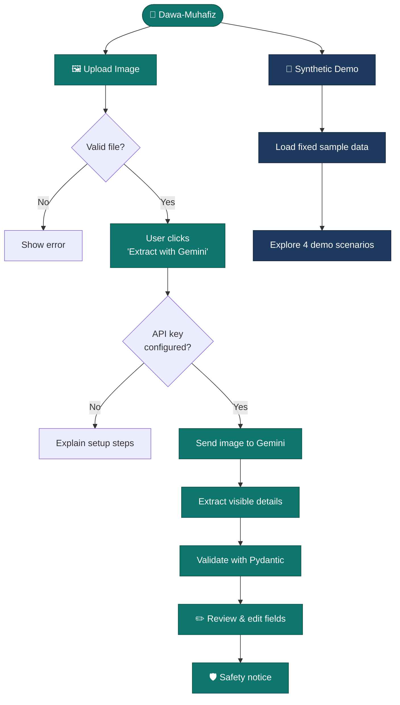

<div align="center">

<!-- Optional: add a logo at docs/assets/logo.png and uncomment -->
<!--  -->

# 💊 Dawa-Muhafiz
### دوا محافظ

**AI-assisted medicine packaging review — read the fine print, so you don't have to squint.**

<br />


<br />

[**Overview**](#-overview) •
[**Features**](#-features) •
[**How It Works**](#-how-it-works) •
[**Quick Start**](#-quick-start) •
[**Roadmap**](#-roadmap)

</div>

<br />

> [!IMPORTANT]
> **Prototype status.** Dawa-Muhafiz currently offers a Streamlit interface, editable medicine details, optional Gemini-powered image extraction, and a clearly labelled **synthetic** demo mode.
> **Real DRAP alert retrieval and alert matching are _not_ implemented.** This project does not authenticate medicines, certify their safety, or provide medical advice.

---

## 🔍 Overview

Medicine packaging carries critical details: **product name, manufacturer, batch number, manufacturing date, and expiry date.** But that text is often tiny, blurred, curved, or poorly printed.

**Dawa-Muhafiz** is an academic project exploring a simple idea:

> Upload a photo of the packaging → let AI extract the visible details → review and correct them yourself → see how an alert-review interface could work.

The long-term vision is to connect reviewed, authoritative medicine-alert data to this workflow. That integration is **future work**, not a capability of the current phase.

<br />

## ✨ Features

<table>
  <tr>
    <td width="50%" valign="top">

### 🖼️ Smart Image Upload
Upload JPG, JPEG, or PNG packaging photos with a default **10 MB** limit and decoded-format validation.

### 🤖 AI-Assisted Extraction
Powered by **Google Gemini vision**. Runs only when an API key is configured *and* the user explicitly requests it.

### ✏️ Human-in-the-Loop Editing
Every extracted field is editable. AI proposes, **you decide**.

    </td>
    <td width="50%" valign="top">

### 🧪 Synthetic Demo Mode
Explore sample details and **four interface scenarios** with no API key required.

### 🛡️ Safety-First Messaging
Clear limitations and prompts to verify details against the original packaging.

### 🧩 Structured & Tested
Shared **Pydantic** schemas validate extracted data, backed by automated **Pytest** tests.

    </td>
  </tr>
</table>

🎨 **Polished UI** — navy-and-teal theme, grouped fields, clear workflow steps, and labelled result states.

<!--
## 📸 Screenshots
Add screenshots to docs/assets/ and uncomment:

| Upload | Extraction | Review |
|:---:|:---:|:---:|
|  |  |  |
-->

<br />

## 🔄 How It Works

Two independent paths: **live AI extraction** and a **synthetic demo**.



> [!NOTE]
> The synthetic demo uses **predefined sample data unrelated to your uploaded image**. Neither workflow performs real DRAP alert retrieval or matching.

<br />

## 🛠️ Technology Stack

| Layer | Technology |
|---|---|
| **Language** | Python 3.11+ |
| **Frontend** | Streamlit |
| **AI** | Google Gen AI Python SDK (`google-genai`) with Gemini vision |
| **Validation** | Pydantic |
| **Testing** | Pytest |
| **Config** | Environment variables via local `.env` |
| **Version control** | Git & GitHub |

<br />

## 🚀 Quick Start

**Prerequisites:** Python 3.11+, Git, and a code editor such as VS Code.

<details open>
<summary><b>1️⃣ Clone the repository</b></summary>

```powershell
git clone https://github.com/itsmeAarishAli06/quantumforge-hackathon.git
cd quantumforge-hackathon
```
</details>

<details open>
<summary><b>2️⃣ Create and activate a virtual environment</b></summary>

```powershell
py -3.11 -m venv .venv
.\.venv\Scripts\Activate.ps1
```
</details>

<details open>
<summary><b>3️⃣ Install dependencies</b></summary>

```powershell
python -m pip install --upgrade pip
python -m pip install -r requirements.txt
```
</details>

<details open>
<summary><b>4️⃣ Configure environment variables</b></summary>

```powershell
Copy-Item .env.example .env
```

Edit `.env` and add your own key to enable live extraction:

```dotenv
GEMINI_API_KEY=your_gemini_api_key_here
```

Optionally set `GEMINI_MODEL` and `GEMINI_TIMEOUT_MS`.

> [!CAUTION]
> **Never commit your real API key.** Keep `.env` excluded via `.gitignore`.
</details>

<details open>
<summary><b>5️⃣ Run the app</b></summary>

```powershell
streamlit run app.py
```

Open the local URL shown in your terminal. **No API key?** Live extraction stays disabled, but the **synthetic demo** works out of the box.
</details>

<br />

## 🤖 Enabling Live Gemini Extraction

1. Visit [Google AI Studio](https://aistudio.google.com/) and obtain an API key.
2. Store it in your local `.env` file.
3. Restart the Streamlit app.
4. Upload a packaging image and click **Extract with Gemini**.
5. **Review every field** against the original package.

Image bytes are sent to Google Gemini **only after you explicitly request extraction**.

> [!WARNING]
> AI extraction is fallible. Small text, poor lighting, curved surfaces, and obscured details can produce missing or incorrect values. Treat ambiguous fields as *unverified*, never as correct by default.

<br />

## 🧪 Testing

```powershell
python -m pytest -q
```

Current tests cover project setup and shared schema validation. They need **no API key** and make **no external network calls**.

> Passing tests does **not** establish medicine-identification accuracy or the reliability of any real-world safety assessment.

<br />

## 📁 Project Structure

<details>
<summary><b>Click to expand the file tree</b></summary>

```text
quantumforge-hackathon/
├── ai/                        # AI extraction layer
│   ├── image_processing.py
│   ├── medicine_extractor.py
│   └── vision_provider.py
├── common/
│   └── schemas.py             # Shared Pydantic data contracts
├── data/                      # Local data (kept out of version control)
├── docs/                      # Architecture & design documentation
│   ├── architecture.md
│   ├── api_contracts.md
│   ├── collaboration_workflow.md
│   ├── data_flow.md
│   ├── database_design.md
│   └── implementation_roadmap.md
├── tests/
│   ├── test_project_setup.py
│   └── test_schemas.py
├── ui/
│   ├── components.py          # Reusable UI components & safety notices
│   └── demo_service.py        # Synthetic demo scenarios
├── verification/              # Foundations for future alert matching
│   ├── alert_matcher.py
│   ├── data_loader.py
│   └── database.py
├── app.py                     # Streamlit entry point
├── requirements.txt
├── .env.example
└── README.md
```
</details>

### Key Modules

| Module | Responsibility |
|---|---|
| 🧭 `app.py` | Streamlit interface, upload validation, session state, editable fields, demo workflow |
| 🤖 `ai/` | Image processing, Gemini integration, structured extraction |
| 🧩 `common/schemas.py` | Shared Pydantic data contracts |
| 🎨 `ui/components.py` | Reusable components, result panels, safety notices |
| 🧪 `ui/demo_service.py` | Fixed synthetic sample details and demo scenarios |
| 🔐 `verification/` | Foundations for future reviewed-data imports and deterministic matching *(not yet functional)* |
| 📖 `docs/` | Architecture, API contracts, data flow, database design, workflow, roadmap |

<br />

## ⚠️ Current Limitations

This is a **prototype**, not a production medicine-verification system.

- ❌ No live DRAP connection or official alert database is queried.
- ❌ No real alert matching is performed.
- ⚠️ Synthetic demo results are **not** generated from the uploaded image.
- ⚠️ AI-extracted details may be incomplete or incorrect.
- ⚠️ A `NO_MATCH_FOUND` status does **not** mean a medicine is genuine, approved, or safe.
- ⚠️ This does not replace pharmacists, healthcare professionals, or official regulatory information.

<br />

## 🔐 Safety & Privacy

Dawa-Muhafiz encourages **careful review over automatic trust** in AI output.

- 🧠 Uploaded images are processed **in memory** and not saved to disk by the current upload workflow.
- 📤 Image bytes go to Google **only** when live extraction is explicitly requested.
- 🙈 Avoid uploading images containing personal or sensitive information.
- 🔎 Always compare extracted details with the original packaging.
- 🚫 Never treat an AI result or synthetic demo as proof of authenticity or safety.
- 🔑 Never commit API keys, personal data, uploaded images, or local databases.

For medicine-related concerns, consult a qualified pharmacist and check official information from the [Drug Regulatory Authority of Pakistan (DRAP)](https://www.dra.gov.pk/).

<br />

## 🗺️ Roadmap

*Potential future improvements, not claims about existing functionality.*

| Phase | Goal | Status |
|---|---|:---:|
| **1** | Streamlit UI, Gemini extraction, editable fields, synthetic demo | ✅ Done |
| **2** | Improve extraction accuracy and field-level review | 🔜 Planned |
| **3** | Stronger validation and error-handling tests | 🔜 Planned |
| **4** | Reliable ingestion of reviewed, authoritative medicine-alert data | 🔜 Planned |
| **5** | Deterministic matching against an approved alert dataset | 🔜 Planned |
| **6** | Traceable evidence and source references for any match | 🔜 Planned |
| **7** | Integration tests with controlled fixtures | 🔜 Planned |
| **8** | Security, privacy, accessibility, and deployment review | 🔜 Planned |

Any future matching should clearly distinguish **confirmed matches**, **uncertain results**, and **cases where no reliable conclusion can be reached**.

<br />

<!--
## 👥 Team
| Name | Role | GitHub |
|---|---|---|
| Aarish Ali | ... | [@itsmeAarishAli06](https://github.com/itsmeAarishAli06) |
-->

## 📚 References

- [Google Gen AI Python SDK](https://github.com/googleapis/python-genai)
- [Gemini Image Understanding](https://ai.google.dev/gemini-api/docs/image-understanding)
- [Gemini Structured Output](https://ai.google.dev/gemini-api/docs/structured-output)
- [Streamlit Documentation](https://docs.streamlit.io/)
- [Pydantic Documentation](https://docs.pydantic.dev/)
- [Drug Regulatory Authority of Pakistan (DRAP)](https://www.dra.gov.pk/)

---

<div align="center">

### 💊 Dawa-Muhafiz

*An academic exploration of AI-assisted medicine packaging review.*

Built for learning, experimentation, and responsible AI development.

<sub>⭐ If you find this project interesting, consider giving it a star.</sub>

</div>
