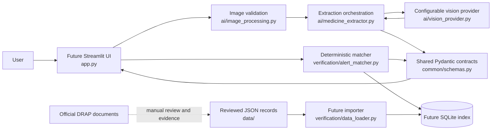

# Dawa-Muhafiz architecture

**Phase:** AI extraction and review. Streamlit supports live Gemini label extraction when configured and a separate synthetic demo path. There is no real database or alert matcher.

## Purpose and scope

Dawa-Muhafiz is planned as a local Python modular monolith for screening packaging details against a reviewed local dataset of official DRAP alerts. The future application extracts what is visibly printed, lets a person review uncertain fields, then compares details with validated alert records. A photograph and missing alert match can never establish that a medicine is genuine, authentic, safe, counterfeit, or approved.

## Component architecture

All modules will run in one process. `common/schemas.py` owns shared Pydantic models and enums; AI and verification modules depend on these contracts, never on each other's implementation. The verifier will be deterministic and independent of the vision provider. JSON source records are portable reviewed inputs; SQLite is a future local query index.

## Module responsibilities

| Module | Responsibility | Current phase |
|---|---|---|
| `app.py` | Streamlit layout, upload validation/preview, session state, Gemini/demo workflow | Implemented |
| `ui/components.py` | Reusable result and safety presentation | Implemented |
| `ui/demo_service.py` | Fixed synthetic extraction and selectable result scenarios | Implemented; no API or matching logic |
| `common/schemas.py` | Single source for medicine, alert, evidence, and result models | Implemented and tested |
| `ai/image_processing.py` | Validate/decode in-memory bytes; impose size and pixel limits | Implemented; JPG/PNG only |
| `ai/vision_provider.py` | Gemini SDK adapter using structured output and bounded timeout | Implemented; requires user API key for live calls |
| `ai/medicine_extractor.py` | Validate image bytes, call provider, parse dates, validate shared contract | Implemented; unit-tested with mocked providers |
| `verification/data_loader.py` | Import reviewed JSON records and provenance into local index | Documented interface only |
| `verification/database.py` | Future SQLite schema/index access | Documented interface only |
| `verification/alert_matcher.py` | Deterministic comparison and evidence-backed result | Documented interface only |
| `data/` | Reviewed source records and provenance guidance | No alert records included |

## Data ownership and safety boundary

AI owns only the extraction of visible text and uncertainty. It must not generate a safety/authenticity verdict or fill unknown values by guessing. The data reviewer owns whether a source record is supported by an original official document. The deterministic matcher owns whether provided fields satisfy explicit comparison rules. The UI owns clear wording and evidence display, not the decision itself.

Only records checked against official source documents may be eligible for positive matches. Every positive match must carry source title, URL, excerpt, and match reasons. Candidate or synthetic records are never presented as official. `NO_MATCH_FOUND` means no match in the available validated records; it does not establish authenticity, approval, or safety. Technical failures yield `ERROR`.

## Error handling

Invalid or corrupt images stop before provider calls. Provider unavailability, malformed provider output, contract validation errors, missing/corrupt database, and query failures remain distinguishable failures and must never be converted into a no-match. User-facing errors should be concise and avoid exposing secrets or raw provider exceptions. Missing/uncertain information is represented explicitly and requests manual review.

## Privacy and security

The current upload handling constrains extension, decoded format, bytes, and pixel count; it keeps image bytes in Streamlit session memory and does not persist files. If Gemini extraction is explicitly requested, the bytes are transmitted to Google's Gemini service. API keys belong in ignored `.env` files, never source or logs. Treat OCR/provider strings as untrusted and render them as text. Future SQL must be parameterized. Do not log uploaded images, personal data, or full provider responses unnecessarily. Keep local databases and runtime artifacts out of version control.

## Future integration points

The agreed functions are `extract_medicine_details(image_path) -> MedicineDetails` and `check_drap_alerts(medicine_details) -> VerificationResult`. Provider configuration will come from environment variables. A future importer will validate JSON before indexing it. The UI will allow review/editing of extracted fields before calling verification. See [API contracts](api_contracts.md), [data flow](data_flow.md), and [database design](database_design.md).

## Included and deferred

Included: shared Pydantic contracts, premium Streamlit review flow, in-memory image validation and preview, Gemini structured extraction when configured, explicit synthetic demo fallback, documentation, and mocked tests. Deferred: SQLite operations, JSON importer, matching logic, DRAP scraping, authentication, deployment, and production medical verification. No actual alert records or live alert-verification results are supplied.
