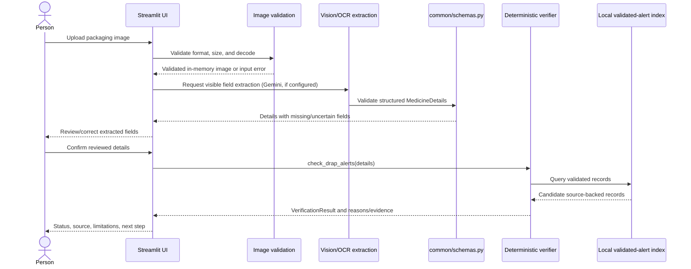

# Planned data flow

**Image validation, Gemini extraction, and review are implemented when the provider is configured.** The interface also offers an explicit synthetic extraction option. The alert lookup portion is still a future design; synthetic result panels remain test fixtures and are not a real match.

The UI validates the upload before sending it to any provider. AI returns only typed extraction fields. Unreadable values stay unknown. After a person reviews details, a deterministic verifier checks the local validated dataset. A positive match includes traceable official evidence. A no-match message says the dataset search found no match and does not imply authenticity or safety. Any failure is an error, not a no-match.
